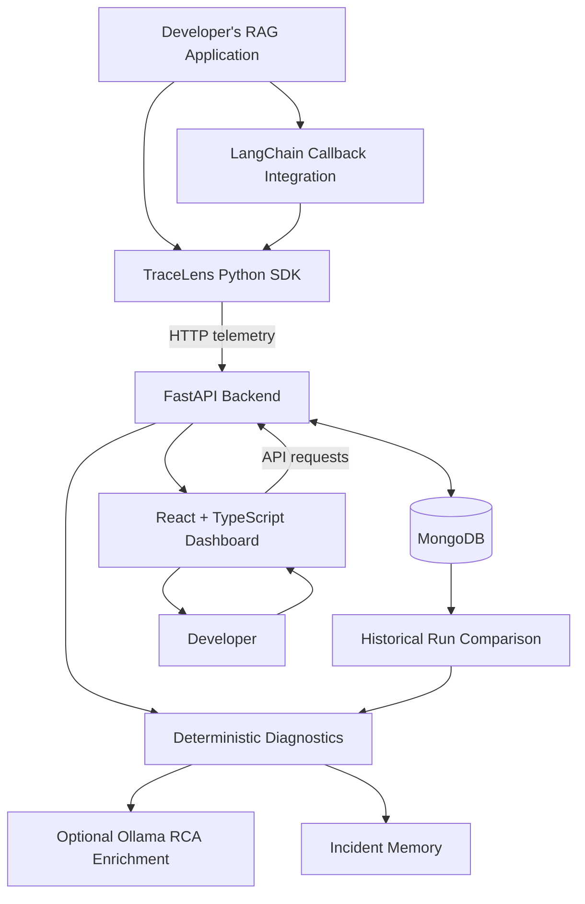
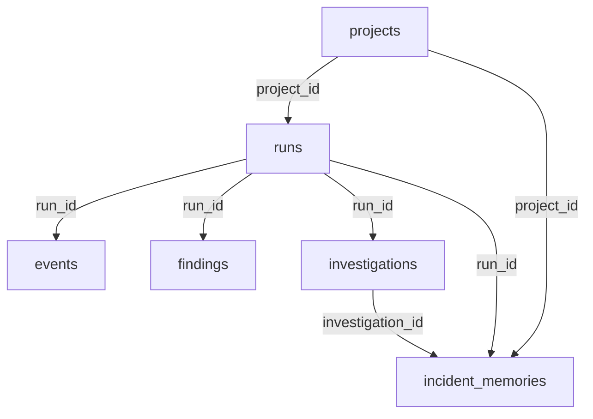
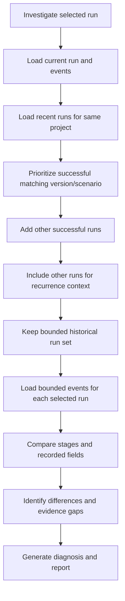
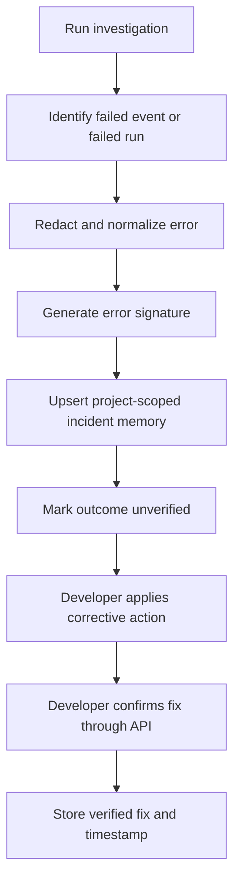
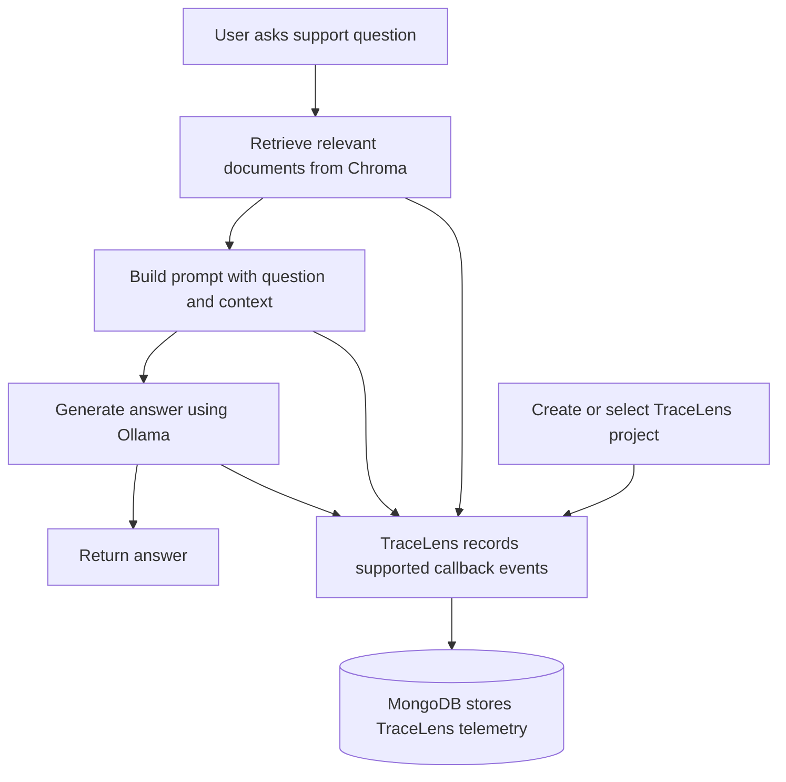

# TraceLens — RAG Observability & Diagnostics

## Complete Project Documentation: Architecture, Workflow, Database Design, Historical Analysis, and Root-Cause Diagnosis

## 1. Project Overview

### What is TraceLens?

TraceLens is a **Retrieval-Augmented Generation (RAG) observability and diagnostics platform**. It helps developers understand what happened inside a RAG application when a pipeline fails, becomes slower, retrieves poor evidence, or behaves differently from a previously successful execution.

A RAG application typically performs several operations:

1. Receives a user query.
2. Converts the query into an embedding or search representation.
3. Retrieves relevant documents from a knowledge base.
4. Constructs a prompt using the retrieved evidence.
5. Sends the prompt to a Large Language Model (LLM).
6. Generates an answer.
7. Returns the answer to the user.

An application may report that a request completed successfully even when retrieval quality has degraded, the wrong documents were retrieved, latency has increased, or the answer is unsupported by evidence.

TraceLens adds observability to these operations by capturing execution traces, persisting run history, comparing runs, detecting suspicious changes, and generating evidence-linked diagnostic reports.

### Problem statement

Traditional application logs often tell developers *that* something failed, but not enough about:

- Which pipeline stage failed first.
- Which stage was last recorded as successful.
- Whether the current model or endpoint differs from a previously working configuration.
- Whether retrieval returned useful evidence.
- Whether the same failure occurred in earlier executions.
- Whether a proposed fix was actually verified.

TraceLens addresses these problems by combining instrumentation, historical data, deterministic diagnostics, optional LLM-assisted investigation, and a dashboard.

### Main objectives

- Capture execution runs and their events.
- Observe important RAG pipeline stages.
- Compare current executions against previous successful runs.
- Identify suspicious stage, configuration, and endpoint differences.
- Produce actionable diagnostic reports with evidence references.
- Retain project-scoped incident memories for recurring problems.
- Provide a dashboard to inspect projects, runs, events, findings, and investigations.

---

## 2. High-Level Architecture

TraceLens consists of five major components:

1. **TraceLens SDK** — instruments application executions and sends telemetry.
2. **TraceLens backend** — receives telemetry, stores records, compares runs, and investigates failures.
3. **MongoDB** — persists projects, runs, events, findings, investigations, and incident memories.
4. **TraceLens frontend** — presents execution history and diagnostic information.
5. **Customer Support RAG demo** — demonstrates how TraceLens can monitor an actual LangChain RAG application.

The demo also uses Chroma for its own vector retrieval and Ollama for local LLM generation. These components serve different purposes from MongoDB.

### Architecture diagram



### How to interpret the architecture

- The RAG application performs its normal work.
- The SDK captures execution information and sends it to the TraceLens backend.
- The backend stores the incoming information in MongoDB.
- When a developer investigates a run, the backend loads the current trace and relevant project history.
- Deterministic logic generates a baseline diagnosis.
- If configured, Ollama enriches the diagnosis with natural-language explanations.
- The investigation and eligible incident memory are persisted.
- The dashboard displays the result.

**Important:** TraceLens is an observability layer. The SDK does not need to replace the developer's existing LLM, retriever, or vector database.

---

## 3. Technology Stack and Why Each Technology Is Used

| Technology | Role in TraceLens |
|---|---|
| Python | SDK, instrumentation, diagnostic logic, and RAG demo |
| FastAPI | Backend REST API |
| MongoDB | Persistent storage for projects, runs, events, findings, investigations, and memories |
| Motor / PyMongo | Asynchronous MongoDB access and MongoDB connectivity |
| React | Dashboard interface |
| TypeScript | Type-safe frontend models and API interactions |
| Vite | Frontend development and build tooling |
| LangChain | Framework used by the example RAG application |
| Chroma | Vector storage and similarity retrieval in the example RAG application |
| Hugging Face sentence-transformers | Text embeddings for the example knowledge base |
| Ollama | Local LLM generation in the example application and optional RCA enrichment |
| Docker Compose | Local MongoDB container and persistent database volume |
| HTTPX | HTTP requests from the SDK and to the optional RCA model service |

The repository also contains tests for SDK behavior, callback integration, diagnostics, investigation, authentication, model validation, and MongoDB API integration.

---

## 4. Why We Use MongoDB

MongoDB is the persistent database used by the TraceLens backend.

The information collected by TraceLens is naturally document-oriented. A run has metadata, an event has a payload, and an investigation has structured evidence, comparisons, recommendations, and limitations.

For example, an event may look conceptually like this:

```json
{
  "event_id": "evt_example",
  "run_id": "run_example",
  "step": "generation",
  "event_type": "llm",
  "status": "failed",
  "timestamp": "2026-10-25T10:30:00Z",
  "duration_ms": 45000,
  "payload": {
    "llm_model": "qwen2.5:1.5b",
    "llm_endpoint": "http://127.0.0.1:11434"
  },
  "error": "Connection refused"
}
```

This is an illustrative example, not a record copied from a live database.

### 4.1 Advantages of MongoDB for TraceLens

**1. Flexible event structure**

Different stages produce different kinds of telemetry. Retrieval events may contain retrieved-chunk counts and relevance scores, while generation events may contain model information, latency, or errors.

MongoDB documents support these varying payload structures without requiring every event to have the same set of columns.

**2. Natural representation of nested data**

Run metadata, event payloads, diagnostic summaries, and structured historical comparisons can be stored as nested documents.

**3. Persistent execution history**

TraceLens must retrieve previous runs after the application has finished. MongoDB stores these records independently of the current Python process.

**4. Queryable historical records**

The backend can retrieve runs belonging to a project, events belonging to a run, and memories belonging to a project.

**5. Index support**

The project defines indexes for identifiers, run history, event timelines, findings, investigations, and incident memories. These support common lookups and ordered history retrieval.

**6. Local development and deployment flexibility**

MongoDB can run locally through Docker Compose or be hosted separately. The current project configuration uses local MongoDB for development.

### 4.2 Why not store everything in files?

JSON files or local log files are useful for simple experiments, but they become inconvenient when the platform needs to:

- Retrieve a project's runs.
- Query the events associated with one run.
- Compare runs repeatedly.
- Update incident memories after a fix is confirmed.
- Serve multiple dashboard requests.
- Maintain indexes over growing history.

MongoDB provides a central, queryable store for these operations.

### 4.3 Why not use a relational database such as PostgreSQL?

PostgreSQL would also be a valid choice. It offers strong relational integrity, transactions, joins, and JSON support.

MongoDB is a reasonable choice for this project because much of the incoming telemetry is structured around documents with varying payloads. It also provides straightforward document retrieval and nested-data storage.

This is a design trade-off, not a claim that MongoDB is universally better than PostgreSQL.

A relational database may be preferable if the application later requires extensive relational reporting, complex joins, strict relational constraints, or analytical queries across many related entities.

### 4.4 Why not use Redis as the main database?

Redis is commonly used for caching, queues, counters, and short-lived state. It can persist data, but it is not the natural default for a durable, document-oriented history of projects, events, investigations, and confirmed fixes.

Redis could complement MongoDB in the future for caching or queue management, but it does not need to replace MongoDB in the current architecture.

### 4.5 Why not use Chroma as the TraceLens database?

Chroma is used by the example RAG application for vector retrieval. Its purpose is different from TraceLens's operational database.

Chroma answers a question such as:

> Which knowledge-base chunks are most similar to this user query?

MongoDB answers questions such as:

> Which runs belong to this project, what events occurred during a run, and what did the investigation find?

The two databases serve different workloads.

### 4.6 MongoDB's role in this architecture

MongoDB is **not the LLM and not the vector search engine**. It is the persistent operational history used by TraceLens to reconstruct, compare, and investigate executions.

---

## 5. Docker-Based MongoDB Setup

The uploaded project contains `docker-compose.yml` with a MongoDB service:

```yaml
services:
  mongodb:
    image: mongo:8
    container_name: tracelens-mongodb
    restart: unless-stopped
    ports:
      - "27017:27017"
    volumes:
      - tracelens_mongo_data:/data/db

volumes:
  tracelens_mongo_data:
```

### What this configuration does

- Uses the MongoDB 8 container image.
- Names the container `tracelens-mongodb`.
- Maps port `27017` to the host machine.
- Uses a named volume called `tracelens_mongo_data` for persistent database files.
- Configures the container to restart unless explicitly stopped.

The volume matters because database files remain outside the container's disposable filesystem. Recreating the container does not normally remove the named volume.

### Start MongoDB

From the project root:

```powershell
docker compose up -d mongodb
```

Check the container:

```powershell
docker compose ps
```

View its logs:

```powershell
docker compose logs mongodb
```

### Backend database configuration

The uploaded backend `.env.example` uses:

```dotenv
MONGODB_URI=mongodb://localhost:27017
MONGODB_DATABASE=tracelens
```

The backend settings in `app/config.py` use these same values as defaults.

The backend creates an `AsyncIOMotorClient` in `app/db.py`, selects the configured database, and uses a startup ping to check connectivity.

The database is therefore separate from the backend process, even when both run on the same computer.

---

## 6. MongoDB Data Model

TraceLens organizes its operational records into collections.

### 6.1 `projects`

Stores registered projects.

Project records identify the application being observed and include information such as:

- `project_id`
- Project name
- Description
- Framework
- Creation timestamp
- Stable project key

A project groups the runs and incident memories associated with one application.

### 6.2 `runs`

Stores individual executions of an application or pipeline.

Important fields include:

- `run_id`
- `project_id`
- `scenario`
- `version`
- `status`
- `baseline_run_id`
- `created_at`
- Run metadata

A run is a single execution, not an individual event.

For example, a customer-support query may create one run containing several events: retrieval, prompt construction, and generation.

### 6.3 `events`

Stores the stages and observations recorded during a run.

Fields include:

- `event_id`
- `run_id`
- `step`
- `event_type`
- `status`
- `timestamp`
- `duration_ms`
- `payload`
- `error`
- Source file and line information when captured
- Trace and parent-event references when available

Each event belongs to a run through its `run_id`.

### 6.4 `findings`

Stores structured results from run-to-run diagnostic comparisons.

A finding may include:

- `finding_id`
- Current `run_id`
- `baseline_run_id`
- Rule identifier
- Severity
- Title and explanation
- Evidence event IDs
- Recommended action
- Creation timestamp

Findings let the dashboard show comparison results without recomputing the same basic comparison every time they are displayed.

### 6.5 `investigations`

Stores generated investigation reports.

An investigation includes the current run, evidence, a timeline, a likely cause, confidence, historical comparison, alternative explanations, recommended actions, and limitations.

The backend saves an investigation document after the diagnostic and optional LLM-enrichment stages.

### 6.6 `incident_memories`

Stores project-scoped summaries of recurring incidents.

These records include information such as:

- `memory_id`
- `project_id`
- `run_id`
- `investigation_id`
- Error signature
- Error category and stage
- Redacted error summary
- Cause summary
- Evidence event IDs
- Outcome
- Verified fix
- Creation and verification timestamps

Incident memory is separate from the complete event history. It stores a compact summary and references instead of copying every raw event payload.

### Relationships between the collections



These are logical relationships expressed through IDs. They should not be mistaken for MongoDB-enforced foreign-key constraints.

### Indexes in the current code

`app/db.py` defines indexes including:

| Collection | Indexed fields | Purpose |
|---|---|---|
| `projects` | `project_id` unique | Identify projects |
| `projects` | `project_key` unique and sparse | Stable project registration |
| `runs` | `run_id` unique | Identify executions |
| `runs` | `project_id`, `created_at` descending | Retrieve project history |
| `events` | `event_id` unique | Identify events |
| `events` | `run_id`, `timestamp` ascending | Load a run timeline |
| `findings` | `finding_id` unique | Identify findings |
| `findings` | `run_id`, `created_at` descending | Retrieve a run's findings |
| `investigations` | `investigation_id` unique | Identify investigations |
| `investigations` | `run_id`, `created_at` descending | Retrieve prior investigations |
| `incident_memories` | `memory_id` unique | Identify incident memories |
| `incident_memories` | `project_id`, `created_at` descending | Retrieve project memories |
| `incident_memories` | `project_id`, `signature` | Find matching incident signatures |

The backend also contains startup logic to consolidate certain legacy duplicate projects before enforcing a unique project-key index.

---

## 7. The TraceLens SDK

The SDK is the instrumentation layer between the developer's application and the TraceLens backend.

Relevant files include:

- `tracelens-sdk/tracelens_sdk/client.py`
- `tracelens-sdk/tracelens_sdk/events.py`
- `tracelens-sdk/tracelens_sdk/integrations.py`
- `tracelens-sdk/tracelens_sdk/decorators.py`
- `tracelens-sdk/tracelens_sdk/privacy.py`
- `tracelens-sdk/tracelens_sdk/cli.py`

### 7.1 SDK responsibilities

The SDK:

1. Creates a run.
2. Records a run-start event.
3. Records stages and their outcomes.
4. Captures durations for supported instrumented operations.
5. Records errors when available.
6. Sends run and event data to the backend over HTTP.
7. Applies payload-sanitization logic before sending data.
8. Supports optional LangChain callback instrumentation.
9. Supports strict and non-strict telemetry delivery behavior.

### 7.2 What is a run?

A run represents one execution of a particular application scenario.

For example:

```text
Run: customer-support-query

    Event 1: chain starts
    Event 2: retrieval starts
    Event 3: retrieval ends
    Event 4: generation starts
    Event 5: generation fails
```

These five events belong to one run.

A second user query creates another run with its own ID and event history.

### 7.3 How does the SDK create a run?

The `TraceLens.start_run()` method returns a run context manager.

Conceptually:

```python
with tracer.start_run(
    "customer-support-query",
    version="1.0.0",
    metadata={"environment": "local"},
) as run:
    # Execute instrumented work.
    ...
```

When the run context begins, the SDK sends a `POST /api/runs` request with the project, scenario, version, optional baseline, metadata, and initial status.

The backend creates and stores the run. The SDK then uses the returned `run_id` to associate events with that execution.

### 7.4 How are events represented?

The SDK defines a `TraceEvent` data class.

An event can contain:

- Step name
- Event type
- Status
- Payload
- Duration
- Error text
- Source location
- Event ID
- Timestamp
- Parent-event reference
- Trace ID

Each event receives a generated ID and a UTC timestamp by default.

The SDK sends events through the backend API rather than writing them directly into MongoDB.

### 7.5 Manual instrumentation

For application-specific functions, developers can instrument steps explicitly.

Conceptually:

```python
with tracer.start_run("support-query") as run:
    with run.trace_step(
        "retrieve-documents",
        event_type="retrieval",
    ):
        documents = retriever.invoke(question)

    with run.trace_step(
        "generate-answer",
        event_type="llm",
    ):
        answer = model.invoke(question)
```

This is an illustrative usage pattern. Actual framework APIs and exception handling depend on the integration being used.

### 7.6 Automatic LangChain instrumentation

The SDK includes a `TraceLensCallbackHandler` that observes supported LangChain callback boundaries.

The handler can capture:

- Root chain invocation
- Nested chain execution
- Model operations
- Retriever operations
- Operation start and end
- Errors reported by supported callbacks
- Durations
- Sanitized input/output shape information
- Selected configuration metadata

It uses LangChain callback run IDs and parent IDs to relate framework operations. It also suppresses duplicate lifecycle callbacks.

The callback intentionally avoids automatically storing raw customer input and generated output. For string values, it records information such as length and a SHA-256 fingerprint; for structured values, it records shape information.

**Limitation:** The integration captures supported LangChain callback boundaries. It does not automatically observe every arbitrary Python function, external process, or infrastructure event. Such operations require explicit instrumentation or another integration.

---

## 8. End-to-End Workflow: From RAG Execution to Diagnosis

### Step 1 — The developer runs a RAG application

A developer uses an existing RAG application, such as the included customer-support assistant.

The application continues to use its normal retriever, knowledge base, and LLM.

### Step 2 — TraceLens instruments the execution

The SDK or LangChain callback handler creates a run and records instrumented operations.

Each event contains the available operational metadata, timestamps, statuses, and errors.

### Step 3 — Telemetry is sent to the backend

The SDK uses HTTP requests to send run and event records to the TraceLens API.

The SDK's client sends telemetry to endpoints such as:

```text
POST /api/runs
POST /api/runs/{run_id}/events
PATCH /api/runs/{run_id}
```

The precise set of calls depends on the operation and SDK behavior.

### Step 4 — The backend persists the records

The FastAPI backend validates incoming data and writes records to the corresponding MongoDB collections.

MongoDB now contains a durable record of the run and its captured events.

### Step 5 — The developer opens the dashboard

The React dashboard requests the health status, projects, runs, events, and findings from the backend.

The developer selects a project and a run to inspect its timeline and recorded outcomes.

### Step 6 — The developer requests an investigation

The dashboard calls:

```text
POST /api/runs/{run_id}/investigate
```

The backend loads the selected run and its events, retrieves recent runs from the same project, and gathers bounded samples of their events.

### Step 7 — Deterministic diagnosis runs

The backend analyzes the recorded errors and statuses, identifies relevant events, and compares the current execution with historical executions.

It produces an initial diagnosis before invoking the optional RCA model.

### Step 8 — Optional Ollama enrichment

When `RCA_PROVIDER=ollama`, the backend attempts to enrich the deterministic report using the configured Ollama model.

If Ollama is unavailable or returns an unusable response, the backend retains the deterministic report and records the relevant AI fallback status.

### Step 9 — Investigation and incident memory are stored

The backend persists the investigation report.

If the run is failed or contains a failed/error event, the backend also attempts to create a redacted, project-scoped incident-memory record. Duplicate memories for the same project, run, and signature are handled through an upsert.

### Step 10 — The developer inspects the result

The dashboard can present the run timeline, historical comparisons, findings, investigation reports, and incident memories.

A proposed fix is not automatically treated as verified. The user can explicitly confirm a corrective action through the incident-memory confirmation endpoint.

---

## 9. The Most Important Logic: Retrieving Previous Successful Runs

This is one of the central features of TraceLens.

The purpose is not simply to show older executions. It is to use previously successful executions as **historical baselines** for diagnosing a current run.

### 9.1 Why successful runs matter

Suppose the same RAG application runs successfully on Monday, but fails on Tuesday.

The previous successful run may record:

```text
Run A — Success
Retrieval endpoint: local vector store
LLM endpoint: http://127.0.0.1:11434
Model: qwen2.5:3b
Generation: Success
```

The current run might record:

```text
Run B — Failed
Retrieval endpoint: local vector store
LLM endpoint: http://127.0.0.1:11435
Model: qwen2.5:3b
Generation: Connection refused
```

These values are an illustrative example.

If the traces contain those exact values, TraceLens can identify the endpoint difference and report that the current generation stage failed while a comparable previous run succeeded using another endpoint.

That difference is evidence supporting a likely cause. It is not absolute proof that the endpoint change caused the failure.

### 9.2 Where is history retrieved?

The backend's investigation endpoint in `app/main.py` first loads the selected run:

```python
run = await db.runs.find_one({"run_id": run_id})
```

It loads the current events in timestamp order:

```python
events = [
    clean(x)
    async for x in db.events.find(
        {"run_id": run_id}
    ).sort("timestamp", 1)
]
```

Then it loads up to 60 recent runs from the same project:

```python
history = [
    clean(x)
    async for x in db.runs.find(
        {"project_id": run["project_id"]}
    ).sort("created_at", -1).limit(60)
]
```

This project filter is important: the diagnostic baseline is drawn from the same project's history, rather than mixing unrelated applications.

### 9.3 How does TraceLens prioritize previous successful runs?

The code separates historical runs into categories.

**First priority: comparable successful runs.**

A run is considered successful when its status is one of:

- `success`
- `succeeded`
- `completed`

The backend then prioritizes successful runs whose version and scenario match the current run, where the relevant fields are available.

**Second priority: other successful runs from the same project.**

If no matching version/scenario baselines are available, other successful project runs can still provide historical context.

**Third priority: other runs, including failed runs.**

Other runs remain useful for identifying recurring failures and understanding project history.

The backend deduplicates the prioritized list by `run_id` and keeps at most 12 runs for the detailed investigation sample.

The 60-run query is the initial history pool; the 12-run selection is the bounded set prioritized for detailed event collection. The historical comparison helper may also use the history passed to it to calculate run-level counts and comparisons.

### 9.4 How are historical events retrieved?

For each selected historical run, the backend retrieves up to 40 events in timestamp order.

Conceptually:

```python
for prior_id in prior_ids:
    per_run_events = [
        clean(x)
        async for x in db.events.find(
            {"run_id": prior_id}
        ).sort("timestamp", 1).limit(40)
    ]
    historical_events.extend(per_run_events)
```

The separate per-run limits help prevent one extremely verbose execution from consuming the entire historical event sample.

### 9.5 How are current and historical runs compared?

The historical comparison logic in `app/investigation.py` works with the captured run and event records.

It:

1. Selects successful historical runs from the same project.
2. Prefers runs with matching scenario and version when possible.
3. Normalizes pipeline stages so corresponding stages can be compared.
4. Compares recorded fields such as endpoints, models, and other configuration metadata.
5. Identifies missing or additional stages.
6. Compares stage statuses.
7. Tracks which historical run and event supplied comparison evidence.
8. Records fields that cannot be compared because older instrumentation did not capture them.

The implementation gives special attention to endpoint/configuration differences associated with a failed stage.

### 9.6 What happens if no successful baseline exists?

TraceLens does not invent a historical baseline.

The report can state that no previous successful same-project run with usable history was available.

It can still diagnose an explicitly recorded failure from the current run, but it cannot claim that a particular setting changed from a known-good value when that value was never recorded.

This distinction is important: **missing historical evidence is not proof of a configuration change.**

### 9.7 Historical comparison flow



---

## 10. Deterministic Diagnostics

TraceLens does not depend entirely on an LLM to understand failures.

The deterministic diagnostic implementation in `app/investigation.py` examines the recorded event history and classifies recognizable errors.

Examples of recognized categories include:

- Python syntax and import errors
- Authentication and authorization failures
- Upstream server errors
- Model context-length problems
- Connection failures
- Missing or incorrectly configured models
- Timeouts
- Retrieval failures or zero retrieved evidence
- Malformed model output
- Other recorded failed stages

The report includes a likely cause, confidence label, evidence event IDs, a timeline, alternative explanations, recommended actions, and limitations.

### Example

Suppose a generation event contains:

```text
Error: Connection refused
Stage: generation
```

The deterministic logic can infer that the generation dependency was unreachable from the application.

It may recommend checking:

- The configured endpoint.
- Whether the service is running.
- Whether the process can reach the endpoint.
- Whether the endpoint matches a previously successful run.

If historical telemetry shows that a comparable successful run used a different endpoint, the diagnosis can promote that difference as stronger evidence.

### Why deterministic logic is useful

- It provides a diagnostic result even without an LLM.
- It makes recognized error classifications predictable.
- It allows evidence references to be validated.
- It avoids treating an LLM-generated explanation as the sole source of truth.
- It gives the LLM a structured report to enrich rather than asking it to diagnose from nothing.

Deterministic rules still have limitations. An error message may be incomplete, a trace may miss an event, and the stage immediately preceding a failure may not be its cause.

---

## 11. Optional LLM-Assisted Root-Cause Analysis

The backend can use Ollama to enrich the deterministic investigation report.

The relevant implementation is in `app/investigation.py`, with provider selection and fallback handling in `app/main.py`.

### How the enrichment works

1. The backend creates a deterministic diagnosis.
2. It assembles a bounded representation of the current run, events, historical runs, historical event samples, and initial hypothesis.
3. It instructs the LLM to compare historical successful runs first.
4. It requires the LLM to distinguish observed facts from hypotheses.
5. It asks for a structured report with evidence, history, alternatives, recommendations, and limitations.
6. The backend validates evidence event IDs against the current run's recorded events.
7. The backend reconstructs the timeline from the stored trace, retaining model-generated explanations only as annotations.
8. The investigation is persisted.

The LLM is instructed not to invent endpoint values, historical differences, event IDs, or unobserved causes.

### Fallback behavior

If the configured Ollama service cannot be reached, times out, returns an HTTP error, or produces an invalid response, the backend retains the deterministic diagnosis and records an appropriate AI status or fallback reason.

This is an important architectural property: the basic investigation does not require successful LLM enrichment.

### Local Ollama configuration

The current backend `.env.example` contains:

```dotenv
RCA_PROVIDER=ollama
RCA_OLLAMA_BASE_URL=http://127.0.0.1:11434
RCA_OLLAMA_MODEL=qwen2.5:3b
RCA_TIMEOUT_SECONDS=45
```

The URL must be reachable from the machine or container running the backend. If the backend runs inside Docker, `127.0.0.1` refers to that container, not automatically to the host machine or another container.

---

## 12. Incident Memory: Learning from Recurring Failures

Historical run comparison and incident memory solve related but different problems.

**Historical run comparison** asks:

> What changed between this execution and previous executions?

**Incident memory** asks:

> Have we seen a similar failure before, and was a corrective action explicitly verified?

### 12.1 When is incident memory created?

After an investigation, the backend creates an incident-memory record when the run status is failed or at least one event contains a failed status or error.

The memory is project-scoped and references the run and investigation that produced it.

### 12.2 How is an error signature generated?

The implementation in `app/memory.py` creates a compact signature from three main ingredients:

1. Error category.
2. Failed stage.
3. Normalized error text.

Before hashing, it redacts common credentials, replaces URLs with a placeholder, normalizes longer numeric sequences, and normalizes whitespace.

It then calculates a SHA-256 hash and retains a shortened signature.

Conceptually:

```text
Category + Stage + Normalized Error
                 |
                 v
             SHA-256
                 |
                 v
         Short error signature
```

This helps identify repeated errors despite some differences in URLs, numbers, or whitespace.

It is not a semantic embedding search. The current signature method is deterministic.

### 12.3 How is a memory match scored?

The helper `memory_match_score()` assigns points:

| Matching feature | Score |
|---|---:|
| Exact error signature | +5 |
| Same known error category | +2 |
| Same known stage | +2 |

The maximum score from these three checks is 9.

This helper provides a transparent similarity score. Its presence does not mean the application automatically performs a complete semantic search over every stored memory.

### 12.4 How are incident memories stored?

The backend uses an upsert keyed by:

- `project_id`
- `run_id`
- `signature`

This prevents the same investigation from repeatedly inserting an identical memory for that same project, run, and signature.

The memory starts with:

```text
outcome = unverified
verified_fix = null
```

### 12.5 How does a fix become verified?

A developer can explicitly confirm a corrective action through:

```text
POST /api/memories/{memory_id}/confirm-fix
```

The backend requires a non-empty fix description, redacts it, and stores:

- `outcome = user_verified`
- `verified_fix`
- `verified_at`
- `verification_source = explicit_user_confirmation`

This is a meaningful distinction: a proposed recommendation is not automatically considered successful merely because an investigation generated it.

**Current implementation boundary:** The confirmation endpoint records the user's explicit confirmation. The code does not independently execute the fix or prove through an automated test that the fix resolved the incident.

### 12.6 Incident-memory workflow



---

## 13. Direct Run Comparison and Findings

TraceLens also provides an explicit comparison endpoint:

```text
POST /api/runs/compare
```

The backend loads both the baseline run and current run.

It checks that both runs exist and belong to the same project, then loads their events in timestamp order.

The `diagnose()` function in `app/diagnostics.py` evaluates the two event sets and produces comparison findings.

Each finding is stored in MongoDB with:

- The current run ID.
- The baseline run ID.
- The finding details.
- Validated evidence event references.
- A creation timestamp.

The response includes baseline and current run summaries, event counts, and findings.

This comparison workflow is distinct from the broader investigation endpoint, which gathers project history, performs historical comparisons, and can use optional Ollama enrichment.

---

## 14. Frontend: What the Developer Sees

The frontend is a React and TypeScript application built with Vite.

The main application shell is in `tracelens-frontend/src/App.tsx`.

It communicates with the backend through HTTP requests and maintains state for projects, runs, events, findings, comparisons, investigations, and incident memories.

### Main user workflow

1. Connect to the TraceLens backend.
2. View the health and database connection status.
3. Select or create a project.
4. Inspect the project's runs.
5. Select a run and inspect its events.
6. Review findings from comparisons.
7. Request an investigation.
8. Inspect the historical comparison, evidence, likely cause, recommendations, and limitations.
9. Review incident memories and confirm a fix when appropriate.

The frontend uses the backend API as its source of truth for persisted records.

It does not connect directly to MongoDB.

### Why separate the frontend from the backend?

This separation provides:

- A dedicated UI for developers.
- A backend that can be used by the SDK without a browser.
- Centralized validation and persistence.
- A clear API boundary.
- The ability to deploy the frontend and backend separately.

---

## 15. The Customer Support RAG Demo

The repository includes `rag-customer-support/main.py` as an example application to demonstrate TraceLens instrumentation.

It uses a knowledge base containing support information such as:

- Access and security
- Billing and subscriptions
- Data and privacy
- Incidents and availability

### RAG workflow



The actual application builds a LangChain chain that retrieves documents, formats the retrieved context, constructs a prompt, invokes the configured model, and parses the response.

The SDK callback integration captures supported LangChain execution boundaries. The example also instruments application startup, because embedding-model loading, vector-store initialization, and configuration failures can occur before the first user query.

### Why does this demo use Chroma and MongoDB together?

Chroma stores and searches vector representations of the support knowledge base.

MongoDB stores TraceLens execution history and diagnostics.

The data flow is different:

```text
Question
   |
   v
Chroma retrieves relevant knowledge-base chunks
   |
   v
Ollama generates the answer
   |
   v
TraceLens records the execution
   |
   v
MongoDB stores the run and events
```

TraceLens does not need to replace Chroma to observe the RAG pipeline.

---

## 16. Privacy and Telemetry Boundaries

The SDK includes payload-sanitization logic, and the LangChain callback deliberately limits the information it captures automatically.

For example, callback input and output summaries can record string length and hash rather than raw text.

Retrieval instrumentation can record a query fingerprint and query length without storing the raw query by default. Chunk details should use safe identifiers, scores, ranks, and source labels rather than full chunk contents.

Incident memory also redacts common credentials before persisting error summaries.

These controls reduce unnecessary exposure, but they should not be described as a guarantee that all sensitive information is always removed.

Before production deployment, developers should review:

- Custom metadata and payloads.
- Error messages that may contain secrets or personal information.
- Source code paths and source locations.
- Retention policies for runs, events, and investigations.
- Access controls for project history.
- Whether the selected deployment requires stronger authentication and authorization.

---

## 17. API Responsibilities

The backend exposes endpoints for the main application workflows.

| Endpoint | Purpose |
|---|---|
| `GET /health` | Report API and database health |
| `POST /api/projects` | Create a project |
| `GET /api/projects` | List projects |
| `PATCH /api/projects/{project_id}` | Update a project |
| `DELETE /api/projects/{project_id}` | Delete a project |
| `POST /api/projects/{project_id}/sdk-key` | Regenerate a project SDK key |
| `POST /api/runs` | Create a run |
| `PATCH /api/runs/{run_id}` | Update a run |
| `GET /api/projects/{project_id}/runs` | Retrieve project runs |
| `GET /api/runs/{run_id}` | Retrieve a run |
| `POST /api/runs/{run_id}/events` | Record an event |
| `GET /api/runs/{run_id}/events` | Retrieve a run timeline |
| `POST /api/runs/compare` | Compare a baseline and current run |
| `GET /api/runs/{run_id}/findings` | Retrieve findings |
| `POST /api/runs/{run_id}/investigate` | Generate and persist an investigation |
| `GET /api/projects/{project_id}/memories` | Retrieve project incident memories |
| `POST /api/memories/{memory_id}/confirm-fix` | Explicitly confirm a corrective action |
| `GET /api/runs/{run_id}/investigations` | Retrieve prior investigations |
| `POST /api/auth/signup` | Register an account |
| `POST /api/auth/login` | Log in |
| `GET /api/auth/me` | Retrieve the current user |
| `POST /api/auth/logout` | Log out |

The backend also includes project-scoped and authentication-related logic. Exact access behavior depends on the configured authentication mode and the request being made.

---

## 18. How to Run the Project Locally

### Step 1 — Start MongoDB

From the repository root:

```powershell
docker compose up -d mongodb
```

Verify the container:

```powershell
docker compose ps
```

### Step 2 — Configure the backend

Navigate to the backend:

```powershell
cd tracelens-backend
```

Create a `.env` file using `.env.example` as the starting point.

The local MongoDB settings are:

```dotenv
MONGODB_URI=mongodb://localhost:27017
MONGODB_DATABASE=tracelens
```

Set the other required environment variables for your chosen local configuration.

### Step 3 — Install backend dependencies

Activate the backend virtual environment if one has already been created, then install the backend requirements:

```powershell
python -m pip install -r requirements.txt
```

Start FastAPI:

```powershell
python -m uvicorn app.main:app --reload --host 127.0.0.1 --port 8000
```

The backend pings MongoDB and prepares its indexes during startup. It does not report startup readiness until the database connection and index setup have succeeded.

### Step 4 — Start the frontend

Open a second terminal:

```powershell
cd tracelens-frontend
npm install
npm run dev
```

The local frontend normally runs at:

```text
http://127.0.0.1:5173
```

The default API URL in the frontend is:

```text
http://127.0.0.1:8000
```

### Step 5 — Start the RAG demo

Configure the root `.env` file using the example settings, install the RAG application's dependencies, and ensure its configured Ollama model is available.

The RAG application's default settings include:

```dotenv
TRACELENS_API_URL=http://127.0.0.1:8000
OLLAMA_MODEL=qwen2.5:3b
OLLAMA_BASE_URL=http://127.0.0.1:11434
CHROMA_PATH=./.chroma
EMBEDDING_MODEL=sentence-transformers/all-MiniLM-L6-v2
RETRIEVAL_K=4
```

These settings belong to the example RAG application, whereas `RCA_OLLAMA_MODEL` and `RCA_OLLAMA_BASE_URL` configure the backend's optional investigation enrichment. They are separate configuration paths and may be set independently.

### Step 6 — Generate telemetry

Run the RAG application, ask a question, and inspect the resulting project and run in the TraceLens dashboard.

To test diagnostics, compare a successful execution with a controlled failure and inspect the generated investigation.

---

## 19. Important Design Decisions and Trade-offs

### Why capture both runs and events?

A run gives the execution-level context: which application, scenario, version, and status.

Events provide the fine-grained sequence of operations within that execution.

Together, they allow TraceLens to move from a high-level failure status to a stage-level investigation.

### Why use historical successful runs?

A failed trace alone may show that a dependency was unreachable. A previous successful trace can provide a concrete reference for what worked before.

This helps distinguish a recorded configuration difference from a generic hypothesis.

### Why use deterministic diagnosis before LLM enrichment?

Deterministic analysis gives the system a predictable baseline. The optional LLM can improve explanation quality, but it is not the sole source of the investigation.

### Why keep incident memories separate from event logs?

Event logs preserve execution detail. Incident memories preserve compact summaries of recurring failures and explicitly confirmed fixes.

This makes the operational history more useful without requiring the developer to repeatedly interpret every raw event.

### Why use MongoDB rather than embedding everything into the LLM context?

MongoDB provides durable storage and indexed retrieval. The backend selects a bounded subset of history for investigation instead of placing the entire database into every model request.

### Why not claim that TraceLens automatically fixes failures?

The current implementation diagnoses failures and recommends actions. Incident memories can record user-confirmed fixes.

It does not automatically modify the developer's application code or guarantee that a recommendation resolves the problem.

---

## 20. Current Implementation Boundaries

For an accurate technical presentation, distinguish implemented functionality from possible future improvements.

1. **Instrumentation coverage:** Automatic coverage depends on the SDK integration. Arbitrary code and external services require instrumentation or another source of telemetry.
2. **Historical comparison:** Comparisons rely on fields captured in the current and historical traces. Missing fields are treated as evidence gaps rather than verified changes.
3. **LLM diagnosis:** Ollama enrichment is optional. Deterministic diagnosis remains available when enrichment fails.
4. **Incident memory:** The signature and match score are deterministic; they are not a semantic vector-search system.
5. **Fix verification:** A stored `user_verified` outcome records explicit user confirmation. It does not mean TraceLens independently proved the fix.
6. **Retrieval quality:** TraceLens can analyze recorded retrieval counts and other available metadata, but it cannot evaluate unrecorded relevance or answer correctness.
7. **Production security:** Local development settings are not a substitute for production authentication, authorization, secret management, and network restrictions.
8. **Causality:** Historical differences support diagnostic hypotheses, but a difference alone does not prove that it caused a failure.

---

## 21. Future Improvements

Potential extensions include:

- More framework integrations beyond the current supported LangChain callbacks.
- More complete retrieval-quality metrics, including grounded relevance evaluations.
- Configurable retention policies for high-volume event collections.
- More sophisticated incident similarity search.
- Automated regression checks against known-good runs.
- Additional alerting integrations.
- More granular production access controls and audit trails.
- Background ingestion for very high telemetry volumes.
- Evaluation datasets for measuring diagnostic accuracy.
- Explicit feedback on whether a recommended fix resolved an incident.
- Dashboards for latency distributions and retrieval-quality trends across many runs.

These are potential extensions, not claims about what the current repository already implements.

---

## 22. Final Summary

TraceLens combines SDK instrumentation, persistent execution history, deterministic diagnostics, historical comparison, optional LLM-assisted explanation, and incident memory.

Its core workflow is:

```text
Instrument an application
        |
        v
Capture runs and events
        |
        v
Send telemetry to FastAPI
        |
        v
Persist records in MongoDB
        |
        v
Load current and historical runs
        |
        v
Compare against successful baselines
        |
        v
Generate evidence-linked diagnosis
        |
        v
Optionally enrich with Ollama
        |
        v
Persist investigation and incident memory
        |
        v
Display findings in the dashboard
```

The central value of TraceLens is that it moves RAG debugging beyond isolated error messages. It gives developers a structured view of what happened, what changed relative to previous successful executions, which evidence supports the diagnosis, and what action can be tested next.

**The key design principle is evidence-based diagnosis:** TraceLens should distinguish recorded facts, historical differences, likely explanations, missing evidence, and user-verified fixes rather than presenting every hypothesis as a confirmed root cause.
